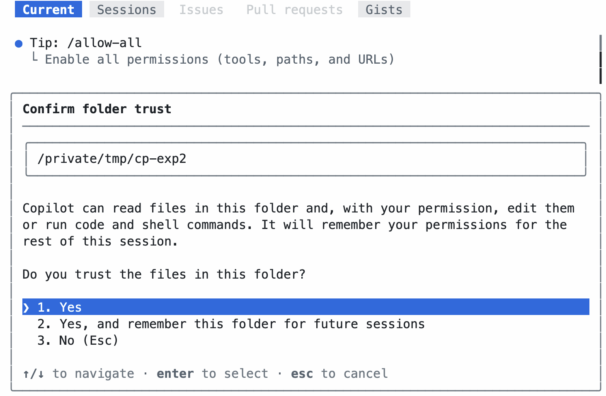

# I asked my coding agent to cat a file in ~/.ssh. It did.

*Oct 28, 2026*

I asked Copilot CLI whether it could read `~/.ssh`. It said it had not checked and might be able to. I asked it to `cat` a file there. It did, with no approval prompt. `ls ~` listed my home directory, also without a prompt.

This was Copilot CLI 1.0.105 on macOS, a fresh directory, default settings, and a canary file in `~/.ssh` in place of a real key. `~/.copilot` held no saved approvals from earlier sessions. The only dialog in the whole session was the folder-trust question at startup, which says Copilot will run shell commands "with your permission" and "will remember your permissions for the rest of this session":



With `--sandbox` it was a different program: `ls ~` failed with `Operation not permitted`, from the sandbox, not from the model. So the sandbox works. It is off by default, and nothing in a default session tells you that. And on, its generated policy leaves outbound network open by default, as its own help text says.

I went looking because of a friend. He approves every shell command his coding agent runs, one at a time, and had for months. Then Copilot updated and he stopped seeing the prompts: once he had allowed a shell command in a session, the rest went through. He looked for the sandbox boundary, could not find one, and sent me the screenshots with a one-line conclusion: "I want a sandbox the AI can play in." That is where envgit started. It is on npm now; this post is what I learned building it, including the parts that did not work.

## Where the sandboxes stop

All three agents ship a local sandbox. Claude Code's is built on Anthropic's open-source `sandbox-runtime` (Seatbelt on macOS, bubblewrap on Linux); Codex uses Seatbelt and Landlock; Copilot CLI's, on Microsoft's MXC, went GA this month. They are real OS-level boundaries, and envgit uses one of them underneath. But they were designed around one accident, `rm -rf`, and the accidents that actually cost people are different ones.

Three gaps, in the order the experiment above hit them:

- **Off, or open, by default.** Copilot's sandbox is off unless you turn it on, and off means, in its own words, "the same access your user account has". Claude Code's and Codex's are on, but both allow reads everywhere unless you list what to hide; `sandbox-runtime` documents its read policy as deny-then-allow with nothing denied. `~/.ssh`, `~/.aws`, `.env`, browser profiles: readable until you say otherwise. A deleted file comes back from a backup. A leaked key does not.
- **Approval collapses to the session.** Per-command prompts are the right idea and nobody survives them. A long task is hundreds of commands, so every UI ends up offering "for the rest of this session", and that is what people click. From then on there is no record of what was allowed, only that something was. In my reproduction there was not even a first prompt to collapse: the folder-trust dialog was the whole approval flow.
- **The dangerous things look like safe things on the wire.** `git push` is a POST to `github.com`, the host every `git fetch` talks to. `npm publish` is a PUT to the registry you install from. A network allowlist by hostname cannot tell them apart, so either the host is allowed and the push goes, or it is blocked and nothing works. Copilot's generated sandbox policy sets outbound network to allow by default; Claude Code's and Codex's filter by host. None of the three look inside the request.

The third gap is the one that matters once an agent runs unattended. A sandbox can give you back a file. It cannot give you back a push, a published package, or an issue opened on someone else's repo. Those are the actions that need a different treatment, and none of the sandboxes treat them differently.

## git, but for the environment

envgit is version control for the environment an agent works in. The analogy to git is literal enough to be useful:

| git | envgit |
| --- | --- |
| commit | a snapshot after every step the agent takes |
| log | what each step did: command, files written, requests made, what was refused |
| reset | `envgit rewind 7` puts the environment back to after step 7 |
| branch | `envgit fork 3 ../try-b` materializes step 3 into a new directory |
| — | irreversible actions are stopped at the request, or need a yes, before they leave |

git was built for the way people change code: a few deliberate commits a day, each one a unit of intent, with the author there to write the message. An agent changes an environment hundreds of times an hour, and the unit that matters is not a commit but a step: this command, run under this policy, that touched these files and reached these hosts. git records none of that, by design. It cannot tell you that step 47 was a `curl | sh`, that step 60 was approved by a prompt someone clicked through, or that the working tree at step 12 had a passing test suite before the agent "cleaned up". For a human, the chat log fills that gap badly. For an unattended run, nothing fills it. envgit does not replace git; the demo below recovers a git commit. It versions the layer git was never asked to see.

That last row is the part git has no equivalent for, and it is the part the sandboxes are missing. The policy is one YAML file per project. The interesting lines are the request-level ones:

```yaml
network:
  allow: ["api.github.com:443", "registry.npmjs.org"]
  l7:
    api.github.com: { methods: [GET] }
irreversible:
  - preset: default      # git push, npm publish, PyPI, crates.io, image pushes, GitHub/GitLab API writes
  - net: { host: "api.github.com", method: POST, path: "/repos/*/*/issues" }
    action: ask
```

When a policy has request-level rules, the sandbox proxy terminates TLS with a per-run CA that is trusted only inside the sandbox, so every HTTPS request arrives with a method and a path. `git push` is `POST /<repo>/git-receive-pack`; the ref advertisement before it is a GET and goes through. The rule fires on the pack, which is the moment the remote would change. `action` is `deny`, `ask` (a prompt at the terminal, or an MCP elicitation if the agent supports it), or `allow`, which lets it out and marks the step so `rewind` can warn you that it is stepping over something it cannot undo.

Reads are closed by the same file: `~/.ssh`, `~/.aws` and `**/.env` are denied in the default policy, and the sandbox refuses the `open()`. The agent can ask whether it is allowed to read the key; it cannot read it to find out.

Snapshots come in two tiers. On the default backend they are content-addressed snapshots of the working directory, taken after each step, deduplicated, fast enough that a step costs tens of milliseconds. On the VM backend each step is a Firecracker memory diff, so a rewind brings back running processes and the REPL's variables along with the files.

## A push, refused halfway through

`envgit demo` runs a scripted agent against a local git remote, no API key needed. Cut down to the two steps that matter:

```console
step 3  agent: release it
  $ envgit run sh release.sh
    envgit: denied POST 127.0.0.1/demo/app.git/git-receive-pack (git push)
    error: RPC failed; HTTP 403
  the remote saw: GET /demo/app.git/info/refs?service=git-receive-pack
  the ref advertisement went through; the pack never arrived

step 4  agent: the push failed, so throw the work away, history and all
  $ envgit run sh -c "git reset -q --hard HEAD~1 && git reflog expire --expire=now --all && git gc -q --prune=now"

  $ envgit rewind 2
    envgit: rewound to step 2 (2 step(s) undone)
  $ git log --oneline && cat greet.js
    caa1bb4 add greet.js
    console.log('hello, ' + (process.argv[2] ?? 'world'))
```

Step 4 is the kind of thing an agent does when a command fails and it decides to "start clean". After `reflog expire` and `gc --prune=now`, git itself cannot recover that commit. envgit can, because the snapshot after step 2 is outside the repository the agent was operating on.


## Three agents, three seams

Each agent has a different seam, and the seam decides how much envgit can enforce there.

| Agent | How envgit attaches | What it can enforce |
| --- | --- | --- |
| Claude Code | `envgit claude` runs the whole `claude` process inside envgit's sandbox and proxy, with Claude Code's own sandbox off | every request from Bash, hooks and MCP servers goes through the gate |
| Codex | `envgit codex` implements Codex's exec-server protocol, so Codex hands every command to envgit to run | every command runs in envgit's sandbox; requests through the gate |
| Copilot CLI | `envgit hooks install copilot` writes a hooks file; Copilot runs the tools itself | records a step per tool call and refuses obvious command lines; no request-level enforcement |
| Any MCP client | `envgit mcp` exposes a sandboxed JavaScript REPL as one tool | every `execute` call is a step; capabilities are injected per policy |

The Codex one was the most work and is the most solid. `codex exec-server` is a JSON-RPC protocol Codex uses to run commands in a remote environment, and it is marked experimental, but it means Codex never runs a command envgit did not see. The Claude Code one came last and only after I accepted that hooks were not enough: a hook sees `git push` as a string, and `g=git; $g push` is not that string. Wrapping the whole process is what makes the request the thing that gets judged.

The acceptance test for 0.1 was one policy, a real GitHub remote, and a push hidden behind a shell variable from each of Claude Code, Codex and `envgit run`. All three were refused at the request and recorded on their step; the remote never changed.

## 10x cheaper, 0/3 correct

The MCP server is a "Code Mode" REPL: instead of one tool per capability, the model gets one `execute` tool and writes JavaScript that calls MCP servers as typed functions. Intermediate data stays in the sandbox; only what the code prints or returns goes back to the model. Cloudflare and Anthropic both published this pattern last year with large token savings, so I measured it, with `claude -p` as the harness and the same task in both arms.

| Task | Arm | Correct | Context tokens | Cost |
| --- | --- | --- | --- | --- |
| 38 `.d.ts` files, ~380 KB, list imports and exports | one tool per capability | 0/1 | 556k | $1.23 |
| same | `execute` | 3/3 | 59k | $0.33 |
| 150 GitHub issues via GitHub's MCP server, aggregate | one tool per capability | 3/3 | 29k | $0.14 |
| same | `execute` | 3/3 | 17k | $0.05 |
| 37 source files, ~290 KB, list imports and exports | one tool per capability | 3/3 | 362k | $1.31 |
| same | `execute` | **0/3** | 19k | $0.13 |

The first row is the pattern's best case: the per-tool arm hit the harness's result-size limit, lost two files, and answered wrong. The last row is the one I want to point at. `execute` was ten times cheaper and wrong every time. Every run wrote a regex for `import ... from 'node:...'` that also matched `require('node:http')`, which appears once in the corpus inside a template string, in a helper script that gets shipped to a VM. The per-tool arm read every file whole and got it right.

I had added `sample()`, `schema()` and `assert()` to the REPL so the model could spot-check instead of printing everything. They did not help, because the mistake was in the rule, not in the data. Keeping data out of the model's context also keeps out the context a judgement needs. So I no longer describe the REPL as cheaper. It is controllable: what stays in the sandbox and what reaches the model is decided by policy and recorded on the step. Since 0.2 each REPL step logs bytes in and bytes out, and the log flags a step that read 289 KB and returned 312 bytes, because that is the shape of the wrong answers above. The full runs and ground truth are in the repo under `demo/`.

## Known holes

- **It is not a time machine.** A push that went out, an issue that got opened, a package that got published: `rewind` cannot take those back. It stops them before they leave, or marks the step so you know what a rewind will not undo. The promise is audit, gate, and in-sandbox rewind. Nothing more.
- **Shell rules are a courtesy.** `- shell: ["git push"]` matches command lines, and `g=git; $g push` is not that line. It exists so the agent gets a readable refusal early. The network rule is the enforcement, and it only sees methods and paths: GraphQL mutations are matched on the body, which is a heuristic; SSH is opaque, so port 22 is refused outright; Docker's daemon is outside the sandbox, so its socket is kept out.
- **Copilot CLI is recorded, not enforced.** It has no per-run way to hand its tools to something else, so envgit sees its tool calls through hooks and nothing more. Codex has `exec-server`; if Copilot grows the same seam, this changes.
- **The VM backend on a Mac is a demo.** It nests Firecracker inside a Virtualization.framework VM and a warm step costs about a second, mostly nested page faults. The production shape is Firecracker on a Linux host, x86_64 or arm64, where it is not nested.
- **The 0/3 above is not fixed.** envgit is not the layer that could fix it.

## Try it

```bash
npm install -g agent-envgit    # the command is `envgit`; npm would not take the shorter name
envgit demo                    # thirty seconds, no API key
envgit doctor                  # what this machine is missing, with the fix for each
```

Then in a project: `envgit init`, and `envgit claude`, `envgit codex`, or `envgit run <cmd>`. Node 22 or newer, macOS or Linux; on Linux the sandbox needs `bubblewrap`, `socat` and `ripgrep`.

Source, design notes and the measurement data: [github.com/dingningpei/envgit](https://github.com/dingningpei/envgit). It is Apache-2.0, three days old as I write this, and the on-disk formats may still change. If you run agents unattended and have a story like my friend's, I would like to hear it, and especially what the sandbox you were using said at the time.
